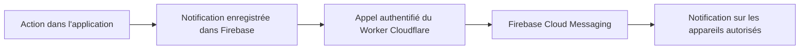

# Notifications push — configuration et déploiement

Le panneau Notifications permet d'activer ou désactiver les notifications sur chaque appareil. Le navigateur demande son autorisation uniquement après un clic. Firebase Cloud Messaging assure la réception ; un Worker Cloudflare dédié assure l'envoi. Le projet Firebase peut rester sur Spark : aucune Cloud Function n'est nécessaire. L'offre Workers Free reste soumise à ses quotas.



Le Worker et l'application ne sont pas encore publiés avec cette configuration. Le déploiement et les essais sur appareils réels restent à effectuer.

## 1. Firebase Cloud Messaging

Dans le projet Firebase `perfect-partners-930b2`, activer l'API Firebase Cloud Messaging HTTP v1. Dans Paramètres du projet → Cloud Messaging → Certificats Web Push, générer une paire de clés.

Ajouter la **clé publique** à `VITE_FIREBASE_VAPID_KEY` dans `.env` et dans les secrets du workflow GitHub Actions. L'URL `VITE_PUSH_WORKER_URL` sera ajoutée après le déploiement du Worker au point 3. Le bouton d'activation devient disponible lorsque ces deux variables sont définies. Ne jamais mettre une clé de compte de service ou la clé privée VAPID dans le client.

## 2. Règles Realtime Database et comptes autorisés

Le 14 octobre 2026, les règles complètes et la liste des comptes autorisés ont été configurées dans la console Firebase, selon confirmation de l'utilisateur. Leur version de référence est conservée dans [database.rules.json](./database.rules.json). L'état distant n'a pas été vérifié depuis ce dépôt.

Les anciennes permissions publiques à la racine (`.read: true`, `.write: true`) ont été remplacées par un refus par défaut. Ne pas les rétablir : une permission accordée sur un parent rend inefficaces les restrictions de lecture et d'écriture de ses enfants.

Dans Realtime Database → Données, le nœud suivant est ajouté à côté des listes existantes, sans remplacer les autres données :

```json
{
  "allowedUsers": {
    "UID_DU_PREMIER_COMPTE": true,
    "UID_DU_SECOND_COMPTE": true
  }
}
```

Les UID proviennent de Firebase → Authentication → Utilisateurs. Ils doivent correspondre uniquement aux deux comptes déjà autorisés dans `src/contexts/authContext.tsx`. Ajouter un autre UID ne constitue pas une autorisation d'élargir l'accès à l'application. Le nœud `allowedUsers` n'est ni lisible ni modifiable par le client ; sa maintenance se fait dans la console Firebase.

| Nœud | Lecture | Écriture |
| --- | --- | --- |
| `movies`, `tvshows`, `games` | Comptes autorisés | Comptes autorisés |
| `users` | Comptes autorisés | Chaque compte autorisé peut modifier son propre profil |
| `notifications/{uid}` | Destinataire autorisé uniquement | Comptes autorisés, vers un destinataire autorisé |
| `pushTokens/{uid}` | Propriétaire autorisé uniquement | Propriétaire autorisé uniquement |
| `allowedUsers` et autres nœuds | Refusée au client | Refusée au client |

Les notifications peuvent être écrites par les deux comptes pour conserver les notifications croisées et les actualisations système existantes. Ces règles ne valident pas encore le contenu ou l'auteur de chaque notification. Les jetons push doivent contenir uniquement une chaîne `token` non vide de moins de 4096 caractères et un nombre `updatedAt`. La suppression d'un abonnement reste autorisée. Le Worker utilise un compte de service pour lire les jetons sans les exposer aux autres utilisateurs.

Le Worker ajoute `pushDeliveries/{uid}/{notificationId}` pour empêcher les envois répétés. Ce nœud est réservé au serveur par le refus d'accès par défaut : aucune nouvelle règle publique n'est nécessaire. Ces petits enregistrements restent conservés et peuvent être nettoyés manuellement après expiration des notifications.

### Compatibilité des appels REST

Les lectures et mutations REST dans `src/api/firebase/{movies,tvshows,games,user}.ts`, ainsi que les synchronisations REST dans `src/api/systemUpdates.ts`, utilisent désormais `firebaseFetch` (`src/api/firebase/rest.ts`). Ce helper obtient un jeton utilisateur via `auth.currentUser.getIdToken()`, l'encode dans le paramètre `auth` et vérifie la réponse HTTP. Les jetons ne sont pas journalisés. Les écritures restent en REST ; les listeners SDK sont authentifiés automatiquement.

Publier cette version de l'application pour rendre les appels REST compatibles avec les règles déjà configurées.

Dans le simulateur de règles Firebase, vérifier : refus d'un utilisateur anonyme ou d'un troisième compte, accès partagé pour les deux comptes autorisés, refus de lecture des notifications ou jetons d'un autre utilisateur, et refus d'écriture du profil d'un autre utilisateur. Ces vérifications distantes restent à effectuer.

## 3. Déployer le Worker Cloudflare

### A. Préparer le compte de service Google

Dans Google Cloud → IAM et administration → Comptes de service, sélectionner le projet `perfect-partners-930b2` et créer un compte dédié aux push. Lui attribuer les rôles :

- **Firebase Realtime Database Admin** (`roles/firebasedatabase.admin`) : lecture des comptes autorisés, notifications et jetons, écriture des marqueurs d'envoi et suppression des jetons invalides.
- **Firebase Cloud Messaging API Admin** (`roles/firebasecloudmessaging.admin`) : envoi via FCM HTTP v1.

Créer une clé JSON pour ce compte. Conserver le fichier hors du dépôt : il contient une clé privée. Ce secret sera utilisé uniquement dans Cloudflare, jamais dans `.env` côté application ou dans une variable `VITE_`.

### B. Vérifier la configuration publique

Ouvrir `workers/push/wrangler.toml` et vérifier les valeurs préparées :

| Variable | Valeur attendue |
| --- | --- |
| `FIREBASE_PROJECT_ID` | `perfect-partners-930b2` |
| `FIREBASE_DATABASE_URL` | URL exacte de la Realtime Database, sans slash final |
| `ALLOWED_ORIGIN` | Origine du site, par exemple `https://votre-compte.github.io`, sans `/Perfect-Partners/` |

Pour les essais locaux, utiliser une configuration distincte avec `ALLOWED_ORIGIN = "http://localhost:5173"` ; ne pas ouvrir l'origine de production à tous les sites.

### C. Installer et publier

Dans un terminal à la racine de `Perfect-Partners` :

```powershell
npm.cmd --prefix workers/push ci
npm.cmd --prefix workers/push test
Set-Location workers/push
npx.cmd wrangler login
npx.cmd wrangler secret put FIREBASE_SERVICE_ACCOUNT
```

À l'invite du secret, coller **tout le contenu du fichier JSON du compte de service**. Si Wrangler propose de créer le Worker avant d'ajouter le secret, accepter la création sous le nom `perfect-partners-push`. Ne pas coller le JSON dans cette conversation ou dans un fichier du dépôt.

Puis déployer :

```powershell
npm.cmd run deploy
```

L'outil affiche l'URL du Worker, par exemple `https://perfect-partners-push.votre-compte.workers.dev`. Le Worker est indépendant du proxy IGDB existant et n'en modifie pas le fonctionnement.

### D. Relier l'application

Ajouter l'URL obtenue à `.env`, puis aux secrets GitHub Actions :

```dotenv
VITE_PUSH_WORKER_URL=https://perfect-partners-push.votre-compte.workers.dev
```

Ne pas ajouter `/send` : le client le fait automatiquement. Redémarrer Vite en local, ou reconstruire et publier le site sur GitHub Pages. Garder aussi `VITE_FIREBASE_VAPID_KEY` dans les deux environnements.

### Fonctionnement et limites

Après une écriture de notification réussie, l'application appelle `POST /send` avec le jeton de connexion Firebase et les identifiants de la notification et du destinataire. Le Worker vérifie la signature, le projet, la validité du jeton et les entrées `allowedUsers`, puis relit le texte et les jetons depuis la base. Le client ne peut pas choisir un texte ou un jeton arbitraire. Le Worker vérifie l'auteur, avec une exception pour les notifications système de nouvelles saisons déjà enregistrées.

Les anciennes notifications de plus de dix minutes, celles déjà lues et celles destinées à l'auteur ne sont pas envoyées. Un marqueur atomique limite les doublons ; les doublons éventuels après une erreur de réseau sont regroupés sur l'appareil par identifiant. Les jetons invalides sont supprimés. La limite de cette implémentation est de vingt appareils par destinataire pour rester sous le quota de sous-requêtes du Worker gratuit.

L'envoi est déclenché par les actions de l'application, pas par toute écriture externe dans Firebase : une modification depuis la console ne génère pas automatiquement de push. Si l'application est fermée avant l'appel au Worker, ou si l'appel échoue, l'activité reste visible dans le panneau mais son push n'est pas garanti. Aucune file persistante ni relance automatique n'est configurée.

Si une ancienne Cloud Function `sendActivityPush` avait déjà été déployée, la supprimer dans la console Firebase pour éviter les doubles envois. Le code `functions/` et `firebase.json` ont été retirés ; le nouveau serveur n'exige pas Blaze.

## 4. Vérification réelle

Après configuration et déploiement :

1. Activer les notifications depuis le panneau et accepter la demande du navigateur.
2. Depuis l'autre compte autorisé, ajouter une œuvre. Vérifier la réception avec l'application ouverte puis fermée.
3. Cliquer sur la notification : la rubrique correspondante doit s'ouvrir sous `/Perfect-Partners/`.
4. Désactiver sur cet appareil puis refaire un ajout : aucun push ne doit arriver.
5. Vérifier que la déconnexion supprime l'abonnement de l'appareil et que les autres appareils continuent de recevoir les notifications.

HTTPS est requis (localhost convient au développement). Sur iPhone/iPad, utiliser une version compatible avec Web Push et ajouter l'application à l'écran d'accueil. Un refus d'autorisation doit être corrigé dans les paramètres du navigateur. La distribution dépend du navigateur et du système ; elle n'est pas garantie lorsque le navigateur est complètement arrêté.

Vérifications locales : `npm run lint`, `npm run build`, `npm --prefix workers/push test` et `npm --prefix workers/push run check` (ce dernier prépare le déploiement sans publier).

Sources : [Configuration FCM Web](https://firebase.google.com/docs/cloud-messaging/web/get-started), [FCM HTTP v1 depuis un serveur externe](https://firebase.google.com/docs/cloud-messaging/send/v1-api), [vérification des jetons Firebase](https://firebase.google.com/docs/auth/admin/verify-id-tokens), [secrets Cloudflare](https://developers.cloudflare.com/workers/configuration/secrets/), [quotas Workers](https://developers.cloudflare.com/workers/platform/limits/), [héritage des permissions](https://firebase.google.com/docs/database/security/core-syntax), [authentification REST](https://firebase.google.com/docs/database/rest/auth).
